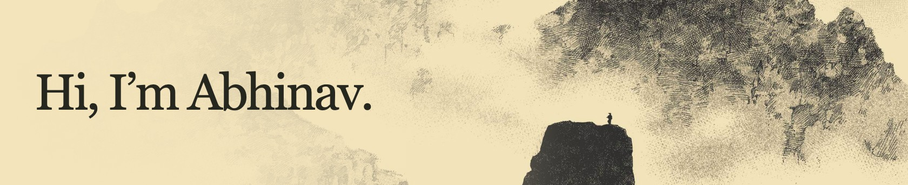
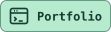

# 

I’ve been independently building and shipping software products while finishing my Computer & Communication Engineering degree at Manipal University Jaipur. My [Retrium OS demo reel](https://www.instagram.com/reel/DbicaGsv5XM/) drew about 130,000 views, and student-led startups reached out about my work.

I’m now looking for an opportunity to work alongside experienced engineers building AI products, ideally in Bengaluru.

  
  
  
  
  

## Selected projects

- **Lalia** is a macOS prototype I’m building to transcribe conversations locally with Whisper and find timestamped passages by keyword or meaning.
- **[Retrium OS](https://retrium.vercel.app/)** is a retro browser desktop with games, a terminal, and a story hidden in its apps.
- **[Flappy Bird AI](https://flappybird-ai.vercel.app/)** lets you watch a genetic algorithm evolve neural networks that learn when to flap.
- **[Follow Check](https://chromewebstore.google.com/detail/follow-check-for-instagra/mackbnaialfjcopijdbkpgabkofafmon)** is a Chrome extension that shows who follows you back on Instagram.

<picture>
  <source media="(prefers-color-scheme: dark)" srcset="https://raw.githubusercontent.com/JustPratiyush/JustPratiyush/output/github-contribution-grid-snake-dark.svg">
  <source media="(prefers-color-scheme: light)" srcset="https://raw.githubusercontent.com/JustPratiyush/JustPratiyush/output/github-contribution-grid-snake.svg">
  
</picture>
